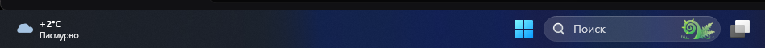
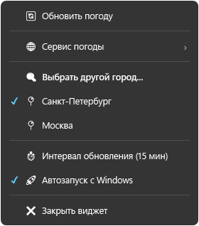
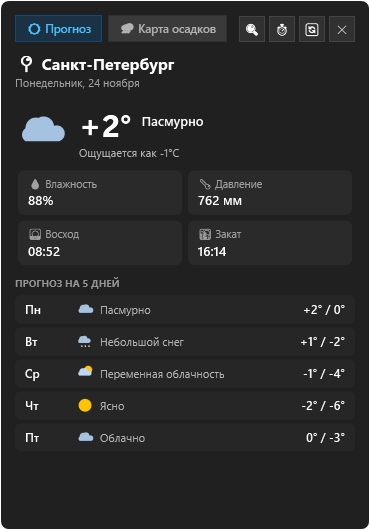
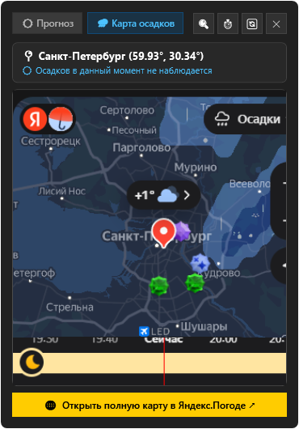
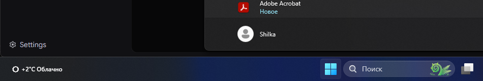

# RuWeatherWidget v1.3.3

> **Нативный погодный виджет для панели задач Windows 11** с интерактивной картой осадков Яндекс.Погоды, подробным прогнозом на 5 дней, выбором сервиса погоды (Яндекс, AccuWeather, Mail.ru), современным меню в стиле Fluent Design и встроенным блокировщиком рекламы.

[](https://microsoft.com/windows)
[](https://github.com/Sh1lka/RuWeatherWidget/releases)
[](https://dotnet.microsoft.com/)
[-008272)](https://developer.microsoft.com/microsoft-edge/webview2/)
[](LICENSE)

---

> [!IMPORTANT]
> ### ⚠️ ОБЯЗАТЕЛЬНО ПОСЛЕ УСТАНОВКИ:
> **Отключите штатный виджет Windows 11 в параметрах панели задач («Виджеты: Откл»)**.
> - Окно параметров панели задач откроется автоматически сразу после завершения установки.
> - Либо откройте вручную: **«Параметры» → «Персонализация» → «Панель задач» → переключатель «Виджеты» переведите в положение «Откл»**.
> - Это необходимо, чтобы штатный виджет погоды Windows не накладывался поверх нашего виджета.

---

## 📸 Скриншоты

### 🔹 Интеграция в панель задач Windows 11
Нативный виджет на панели задач рядом с кнопкой «Пуск» и поиском, полностью повторяющий Fluent-стиль Windows 11:
<p align="center">
  
</p>

### 🔹 Современное контекстное меню Windows 11 Fluent Design
Стильное контекстное меню без серого оформления в стиле Windows XP — скругленные углы, акцентная индикация, тёмная/светлая тема и переключение погодных провайдеров на лету:
<p align="center">
  
</p>

### 🔹 Прогноз погоды и интерактивная карта осадков
Всплывающее окно (Flyout) по клику на виджет: подробный 5-дневный прогноз и радар осадков:

| ☀️ Подробный прогноз на 5 дней | 🌧️ Интерактивная карта осадков Яндекс |
|:---:|:---:|
|  |  |

### 🔹 Надежная работа при открытом меню «Пуск»
Виджет привязан к системному слою (`ZBID_SYSTEM`) как подчинённое окно (`Owned Window`) — он никогда не исчезает и не перекрывается при открытии меню «Пуск» или нажатии клавиши Win:
<p align="center">
  
</p>

---

## 🚀 Что нового в версии 1.3.3

- 🛡️ **Блокировка внешних ссылок и всплывающих окон на карте:**
  - Заблокирована возможность перехода по любым внешним ссылкам внутри карты радара (включая логотип «Яндекс Погода» в левом верхнем углу карты, ссылки меню и копирайты). Логотип отображается статично без кликабельности (`pointer-events: none`).
  - На уровне WebView2 перехватываются события `NavigationStarting` и `NewWindowRequested`, предотвращая любой уход с интерактивной карты осадков.
  - Удалены навязчивые всплывающие окна опросов и отзывов («Как вам Яндекс Погода?»), перекрывавшие обзор карты.
  - Все интерактивные элементы карты (перемещение, масштабирование колесиком мыши, кнопки приближения/отдаления, геолокация и таймлайн осадков) сохранены и работают в полном объеме.
  - Желтая кнопка «Открыть полную карту в Яндекс.Погоде ↗» сохранена внизу страницы и стилизована по гайдлайнам Fluent Design / UI/UX Pro Max со скруглениями 6px и эффектом наведения.

---

## 🚀 Что нового в версии 1.3.2

- ☀️ **Исправление 5-дневного прогноза погоды Яндекс:**
  - Устранено ошибочное попадание навигационных ссылок («Неделю», «Выходные», «Картах») и SVG-разметки в список прогноза. Теперь данные извлекаются напрямую из карточек подробного прогноза по дням: отображаются корректные дни недели («Сегодня», «Завтра», «Четверг», «Пятница», «Суббота»), точные температуры ночь/день и метеоусловия.
  - Исправлено задвоение значка градуса в блоке «Ощущается как» (`-2°°` -> `-2°`).
- 👤 **Издатель в установленных программах изменен на `Sh1lka`:**
  - В реестре Windows (раздел «Установка и удаление программ» / «Параметры -> Приложения») издателем виджета теперь отображается **Sh1lka** вместо Antigravity.
- ⚙️ **Умное открытие параметров панели задач:**
  - Окно «Параметры панели задач» (`ms-settings:taskbar`) теперь открывается инсталлятором **только в том случае, если штатный виджет Windows действительно включен** в системе (`TaskbarDa == 1`). Если виджет уже отключен, окно параметров не появляется и не отвлекает пользователя.

---

## 🚀 Что нового в версии 1.3.1

- 🛡️ **Полный иммунитет к кнопке «Свернуть все окна» / Win+D:**
  - Устранена проблема, при которой клик по узкой полоске в правом нижнем углу экрана (или нажатие сочетания клавиш `Win + D` / `Win + M`) приводил к сворачиванию/скрытию погодного виджета с панели задач.
  - В оконную процедуру виджета внедрен перехват системных сообщений минимизации и сокрытия:
    - Блокировка `WM_SYSCOMMAND` с параметром `SC_MINIMIZE`.
    - Блокировка `WM_SHOWWINDOW` при попытке шелла скрыть окно (`wParam = FALSE`).
    - Блокировка `WM_SIZE` с состоянием `SIZE_MINIMIZED`.
    - Фильтрация `WM_WINDOWPOSCHANGING`: удаление флага `SWP_HIDEWINDOW` и отмена переноса координат окна в скрытую область (`-32000, -32000`).
  - Таймер синхронизации теперь контролирует `IsWindowVisible` и `WindowState`, гарантируя удержание виджета на системной панели задач в любых условиях.

---

## 🚀 Что нового в версии 1.3

- 🌐 **Выбор сервиса погоды (Яндекс.Погода, AccuWeather, Погода Mail.ru):**
  - Возможность мгновенного переключения источника метеоданных прямо из контекстного меню виджета.
  - **Яндекс.Погода**: работает из коробки без API-ключей, стабильно и быстро в РФ.
  - **AccuWeather**: поддержка глобального провайдера с возможностью указания своего API-ключа через удобный диалог.
  - **Погода Mail.ru**: надежный альтернативный отечественный источник.
- 🎨 **100% Fluent Design для контекстного меню:**
  - Полностью переработано стандартное контекстное меню Windows XP: теперь используется современный стиль Windows 11 со скруглениями 8px, системным шрифтом `Segoe UI Variable Text`, плавной анимацией наведения и стильными индикаторами выбранного провайдера.
- 🪟 **Надежное закрытие всплывающего окна (Flyout):**
  - Реализован глобальный системный хук мыши (`WH_MOUSE_LL`): теперь окно гарантированно закрывается при клике на любое место рабочего стола (включая пустое пространство обоев `WorkerW`/`Progman`), панель задач или другое приложение.
  - Устранена проблема самопроизвольного закрытия окна: добавлена защита от потери фокуса при инициализации дочерних процессов `msedgewebview2.exe`.
- 🎯 **Улучшенный отклик и кликабельность кнопки виджета:**
  - Оптимизирована зона клика виджета на панели задач (ширина увеличена до 165px).
  - Устранен периодический сброс фокуса мыши Win32 таймером `SetWindowPos`, из-за которого клики в некоторых областях не срабатывали с первого раза.
- 🚀 **Обновлённый инсталлятор 1.3.0:**
  - Обновлена упаковка и версии всех исполняемых файлов.

---

## 🚀 Что нового в версии 1.2

- 🔒 **Виджет больше не исчезает при нажатии кнопки «Пуск»:**
  - Окно виджета зарегистрировано как подчинённое окно (`Owned Window`) системного окна `Shell_TrayWnd` через Win32 API (`GWLP_HWNDPARENT`).
  - По правилам оконного менеджера Windows подчинённое окно гарантированно удерживается поверх своего владельца (`Shell_TrayWnd`) в системном слое (`ZBID_SYSTEM`), поэтому при открытии меню «Пуск» или нажатии клавиши Win виджет остаётся на месте и не перекрывается.
- 🚫 **Убрана иконка открытой программы с панели задач:**
  - Применены системные стили `WS_EX_TOOLWINDOW` и `WS_EX_NOACTIVATE`, снят стиль `WS_EX_APPWINDOW`, а также вызван официальный COM API `ITaskbarList::DeleteTab`, что исключает появление отдельной кнопки на панели задач.
- 📐 **Поддержка выравнивания значков панели задач (Center и Left):**
  - Автоматическое определение положения значков панели задач (`TaskbarAl`): если иконки выровнены по левому краю, виджет автоматически размещается возле системного трея, не конфликтуя с кнопкой «Пуск» и закрепленными иконками.
- 🛠️ **Автоматический запуск параметров панели задач:**
  - Инсталлятор теперь автоматически открывает системное окно `ms-settings:taskbar` сразу после установки, позволяя в 1 клик отключить штатные виджеты Windows.
- 🎨 **100% нативный Fluent-дизайн:**
  - Полная прозрачность без черных рамок и без разрезания панели задач (`SetWindowRgn`), плавная подсветка при наведении, автоматическая адаптация под светлую и тёмную тему Windows.
- 📍 **Интеграция геолокации и быстрый выбор городов:**
  - Нативная кнопка определения координат на карте осадков Яндекс.Погоды и сохранение 3 последних выбранных городов в контекстном меню.

---

## 🌟 Основные возможности

- 🌤️ **Нативная интеграция в панель задач Windows 11:** 
  Виджет размещается слева на панели задач (или возле трея при левом выравнивании), полностью повторяя дизайн штатного погодного виджета.
- 📊 **Подробный прогноз погоды:**
  Всплывающее окно (Flyout) в стиле Fluent Design с текущей температурой, ощущаемой температурой, деталями влажности, давления и прогнозом на 5 дней.
- 🌅 **Восход и заход солнца:**
  Отображение точного времени восхода и заката для выбранной локации.
- 🌧️ **Интерактивная карта осадков Яндекс.Погоды:**
  Встроенная карта осадков на базе **Microsoft WebView2 (Chromium)**:
  - Полноценное перемещение мышью (drag-to-pan).
  - Масштабирование колёсиком мыши (zoom in / zoom out).
  - Интерактивный таймлайн прогноза осадков на 2 часа вперёд.
  - Кнопка определения местоположения прямо на карте.
- 🛡️ **Встроенный AdBlock:**
  Полное отключение рекламы на карте осадков на сетевом уровне и через CSS/DOM-фильтрацию.
- 🔍 **Поиск городов с автодополнением:**
  Удобное диалоговое окно поиска с подсказками по городам России и мира.
- ⏱️ **Гибкая настройка интервала обновления:**
  Выбор интервала обновления погоды (от 5 минут до 2 часов или произвольный).
- 🚀 **Автономный однофайловый установщик:**
  Установщик `RuWeatherWidget_Setup.exe` включает все зависимости и устанавливает виджет в автозагрузку в один клик.

---

## 🚀 Установка

1. Скачайте **`RuWeatherWidget_Setup.exe`** из раздела [Releases](https://github.com/Sh1lka/RuWeatherWidget/releases/latest).
2. Запустите установщик и нажмите **«Установить»** (также поддерживается тихий режим установки через флаг `/silent`).
3. В открывшемся системном окне параметров панели задач выключите пункт **«Виджеты»** (переведите в «Откл»).
4. Виджет автоматически появится на панели задач и добавится в автозагрузку.

---

## 🛠️ Сборка из исходников

Для компиляции проекта не требуется установка Visual Studio — сборка выполняется стандартным компилятором `csc.exe` из поставки .NET Framework 4.x:

```powershell
# 1. Сборка исполняемого файла виджета
.\compile.ps1

# 2. Сборка автономного однофайлового инсталлятора
.\build_installer.ps1
```

Готовый файл установщика будет создан в папке `Release\RuWeatherWidget_Setup.exe`.

---

## 📁 Структура проекта

```text
RuWeatherWidget/
├── RuWeatherWidget/
│   ├── Program.cs                      # Основной код виджета (WPF, трей, WebView2, парсинг)
│   ├── app.ico                         # Фирменная Fluent-иконка приложения
│   ├── Microsoft.Web.WebView2.Wpf.dll   # Библиотека интеграции WebView2 для WPF
│   ├── Microsoft.Web.WebView2.Core.dll  # Ядро WebView2
│   └── WebView2Loader.dll              # Загрузчик среды Chromium
├── Installer/
│   └── SetupProgram.cs                 # Исходный код однофайлового инсталлятора и деинсталлятора
├── docs/
│   └── screenshots/                    # Скриншоты приложения для README и релизов
├── compile.ps1                         # Скрипт быстрой компиляции виджета
├── build_installer.ps1                 # Скрипт упаковки всех компонентов в Setup.exe
├── restart_widget.ps1                  # Скрипт чистого перезапуска виджета
├── .gitignore
└── README.md
```

---

## 📄 Лицензия

Распространяется под лицензией MIT. Подробности в файле [LICENSE](LICENSE).
